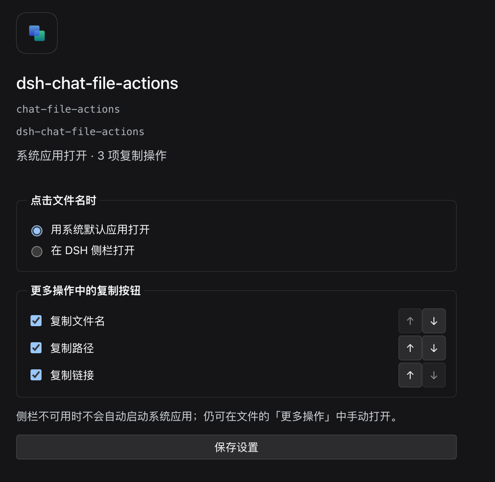

# 对话文件操作 · DSH Chat File Actions

一个 DeepSeek Harness 插件：在已完成的回复下按需显示「本轮资源」，集中操作本轮明确引用的本地文件、网页链接和已编辑文件。不覆盖右键菜单，也不修改 DSH 本体。

> 面向 DeepSeek Harness **0.2.0-rc.2**。**0.4.0** 通过 33 项自动化测试，已在用户的 macOS DSH Profile 中安装试用；系统应用与文件管理器操作发生在 **DSH Host 所在电脑**，侧栏查看发生在 DSH 页面。Windows 桌面尚未实测。

## 效果预览

**紧凑的文件列表**：按文件类型显示名称，可直接定位或展开更多操作。


**按需显示复制操作**：展开「更多」后，可复制路径、文件名或 Markdown 链接。


**在插件管理页调整设置**：选择文件名的打开方式，勾选并排列「更多操作」中的复制按钮。



这些截图展示已发布 0.3.0 的布局；0.4.0 的网页链接沿用同样的紧凑单行样式，仅增加链接图标与淡色真实域名。前两张截图只保留插件弹层，已裁去对话和费用信息；设置页截图演示将「复制文件名」排在首位。

## 使用

本轮提问或回复含明确的本地 Markdown 文件链接（包括图片）、`@path`、`@"path with spaces"`、Markdown `http(s)` 网页链接，或本轮有成功的结构化 `edit`／`write` 文件结果时，回复操作栏才显示回形针图标和候选数。它们在同一紧凑列表中显示，不另分两套界面。点击图标后：

- **点击本地文件名**：默认请求系统应用打开；也可在插件管理页设为「在 DSH 侧栏打开」。成功编辑的文件以淡色「已编辑」标注。
- **点击文件夹图标**：请求 Host 的文件管理器定位已验证的本地文件。
- **文件的「更多」**：复制绝对路径、文件名或 Markdown 链接；可在插件管理页调整这三项的显示与顺序。侧栏模式下始终提供「用系统应用打开」备选。
- **点击网页链接名**：在浏览器打开；同一行显示实际目标域名，而非只相信链接标题。「更多」可复制网址或 Markdown 链接；网页链接没有本地文件定位操作，文件打开方式配置也不影响它。

进入插件管理器的「对话文件操作」配置页，选择**本地文件名**的打开方式，勾选并用上下按钮排列**本地文件**的复制操作，然后保存。默认设置与 0.2.1 一致；如果三个文件复制项都隐藏，系统打开模式的文件行不显示「更多」按钮；网页链接行仍可复制网址或 Markdown 链接。设置保存在 DSH Host 的 Profile 配置中；若 DSH 判定当前连接不是 loopback，设置页不可持久保存，也不会退而使用浏览器本地存储。

**语言跟随 DSH 全局设置**：切换「中文／English」后，插件管理器中的名称、简介、设置摘要和表单，以及已经展开的本轮资源弹窗、菜单、读屏标签和操作反馈都会切换；无须给插件另设语言，也不会改变已保存的打开方式和复制顺序。

列表默认只显示文件名；同名文件会补充父目录，悬停可查看完整路径。标题固定，文件列表独立滚动。界面使用 DSH 日夜主题色、线性图标和文件类型图标，支持键盘操作。

## 安装

从 [v0.4.0 Release](https://github.com/nico-zhuang/dsh-chat-file-actions/releases/tag/v0.4.0) 下载 `dsh-chat-file-actions-0.4.0.tgz`；旧版仍可从 [v0.3.0 Release](https://github.com/nico-zhuang/dsh-chat-file-actions/releases/tag/v0.3.0) 下载。

1. 在 DSH 插件管理器中安装下载的本地包并启用 **对话文件操作**。
2. 若提示 `restart-required`，保存其他任务后**手动重启 DSH**；只刷新页面可能不够。

从源码构建：

```sh
npm ci --ignore-scripts --no-audit --no-fund
npm test
npm pack --ignore-scripts
```

本仓库未发布到 npm registry。`package.json` 保留 `private: true`，以防误发布；GitHub Release 中的 `.tgz` 才是对应版本的安装包。禁用或移除插件会撤销操作栏插槽和样式，不会修改会话文件。

## 实现与边界

- 通过正式插槽 `conversation.chat.assistant-actions`，只收集当前 `messageId` 所属单轮、单会话的候选；没有候选就不显示按钮。文字仅解析明确的本地 Markdown 文件链接、`@文件`引用和 Markdown `http(s)` 链接；不猜测普通裸网址、代码块、HTML 注释或工具输出中的裸文件名。暂不支持参考式链接及全部复杂 Markdown 语法，带括号的常见 URL 与嵌套方括号标题受有界扫描支持；文件与网页目标会按 Markdown 规则解释常见实体和转义，无法确定的实体会跳过，以免指向错误目标。
- 同轮成功完成的 DSH `edit`／`write` 卡从 Chat snapshot 的结构化 `tool-result` 和 diff／创建元数据取路径，不解析卡片 DOM 或工具结果散文；失败、隐藏、越过本轮回复、缺少必要元数据的结果均忽略。**这是 DSH 0.2.0-rc.2 的版本特定运行时结构，不保证未来 DSH 版本不变。** shell 等其他方式修改的文件不会自动枚举。
- 本地文件展开时以所属 `sessionId` 调用 DSH 的 `workspaceFiles.stat`，由 Host 确定会话工作目录及回退目录。工具卡路径也由 Host 重新验证；验证失败时禁用文件操作。文件可能位于工作区外；Host 也可能拒绝最终符号链接。网页链接只接受规范化的 `http(s)` 绝对地址，拒绝带用户名密码、原始空白／反斜杠、非网页协议；显示真实域名，只有用户点击才由浏览器打开，不走文件 Host API，也不主动抓取网页。
- 每轮最多显示前 **200** 个资源，优先给成功编辑／创建的文件预留额度；**每次展开**最多并发 **6** 个本地文件验证请求。关闭弹层会发出取消信号并忽略过期结果；若旧请求不响应取消，连续展开期间在途请求可能超过 6 个。
- 系统打开和定位调用 DSH 的 `session.openWorkspacePath`，插件不运行 shell 命令；原生命令被受理也不保证窗口实际出现。侧栏模式调用 DSH 原生 `sidebarRight.openResource`，使用已验证文件的会话地址，并核对当前显示的 `sessionId`；侧栏不可用时不自动改为系统打开。文档预览由 DSH 决定：图片、PDF 可在页面查看，Office 需要 Host 转换，均受格式、文件大小与服务可用性限制。只有点击复制按钮才会写入剪贴板。
- 本地文件打开方式和有序复制项由 DSH 的 Host Config／配置表单保存；配置还未读取或不可用时禁用文件名主按钮，保留显式系统打开入口。网页链接不受文件打开方式影响：主动作是带 `noopener noreferrer` 的浏览器链接，次要动作复制网址或 Markdown 链接。侧栏不依赖 `dsh-better-sidebar`，也不注册新的预览器。
- 中英文 UI 由 DSH Client 的 `locale` 服务读取 `zh`／`en` 全局选择并订阅切换；插件管理器的名称和简介则由包内 `locale/zh.json`、`locale/en.json` 元数据提供。Host Config 仍只保存与语言无关的动作 ID，不增加独立语言偏好。DSH 其他语言若回退到英文，插件文案也跟随服务的回退链。
- Windows Markdown 路径建议使用 `/`、将反斜杠编码为 `%5C`，或使用插件生成的「复制链接」。原始 `C:\work\.env` 等反斜杠紧贴 Markdown 标点的写法有歧义，插件会跳过，以免指向另一个文件；`@"C:\work\.env"` 引用不经 Markdown 转义。暂不支持 UNC 和 `file:` 形式的 Markdown 文件链接。
- 自动测试模拟 React 和 Remote，不能代替各操作系统、各 DSH 版本的实机验收。报告兼容问题时，请在 GitHub Issues 提供 DSH 版本和复现步骤，不要公开私人路径、令牌或完整会话记录。

## 开发

浏览器入口 `lib/client.js` 使用 DSH `locale`、`configForms` 和现有文件 Remote；Host 入口 `lib/index.js` 仅声明由 DSH 设置服务管理的 Config schema，不增加命令权限或自建路由。插件管理器的翻译元数据位于 `locale/zh.json` 和 `locale/en.json`，清单位于 `package.json`、`cordis.patch.yml`。测试覆盖语言服务订阅、管理器与弹窗热切换及配置不变性、单轮隔离、带括号外链与真实域名、安全协议过滤、结构化编辑／新建卡、会话路径验证、复制、限流、配置保存与排序、侧栏会话匹配及不可用时的显式备选。

本项目是独立社区插件，与 DeepSeek Harness 官方无隶属关系。许可证见 [LICENSE](./LICENSE)。

---

## English

**DSH Chat File Actions 0.4.0** adds a paperclip beneath completed replies for explicit local-file references, Markdown `http(s)` links, and successful same-turn `edit`/`write` file cards. All entries share the same compact single-line list. A local file opens with the Host's default app (the unchanged default) or, if configured, in DSH's native right sidebar; Reveal and the configurable copy actions remain file-only. A web link opens in the browser and offers Copy URL / Copy Markdown under the same **More** style, with its true destination host shown beside the label.

The plugin follows DSH's global Chinese/English setting: the plugin-manager title, description, settings summary and form, plus the open resource popup, menus, accessibility labels and feedback switch live. File-action preferences remain unchanged; there is no separate plugin language preference.

The compact list follows DSH's theme and scrolls independently. Up to 200 combined resources are shown, reserving room for applied edit/write files. Local paths—including those taken from tool-card metadata—are verified through the owning session's `workspaceFiles.stat`, with at most six concurrent checks **per opening**; cancellation is best-effort. Web links do not call Host file APIs and never load automatically. Sidebar opens require the addressed Session to be on screen and an available DSH preview; they never silently launch a Host app on failure. Profile settings are Host-owned and writable only from pages DSH treats as loopback. The structured tool-card contract is specific to DSH 0.2.0-rc.2, not a promised stable API.

Download the archive from the [v0.4.0 Release](https://github.com/nico-zhuang/dsh-chat-file-actions/releases/tag/v0.4.0) and install it through the DSH plugin manager; restart manually if DSH reports `restart-required`. The previous [v0.3.0 Release](https://github.com/nico-zhuang/dsh-chat-file-actions/releases/tag/v0.3.0) remains available. Version 0.4.0 passed 33 automated tests and has been installed for testing in the user's macOS DSH profile. Developed against DSH 0.2.0-rc.2; Windows desktop operation remains unverified. Independent community plugin, not an official DeepSeek product.
