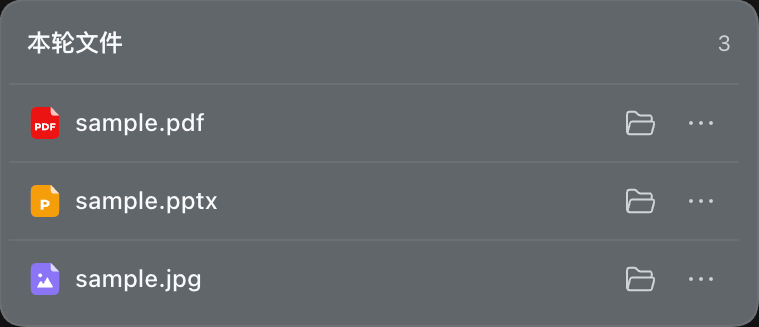

# 对话文件操作 · DSH Chat File Actions

一个 DeepSeek Harness 插件：在已完成的回复下按需显示「本轮文件」，集中打开、定位和复制本轮引用的本地文件。不覆盖右键菜单，也不修改 DSH 本体。

> 面向 DeepSeek Harness **0.2.0-rc.2**。系统应用与文件管理器操作发生在 **DSH Host 所在电脑**；侧栏查看发生在 DSH 页面。0.3.0 通过 20 项自动化测试，并经用户在 macOS 上试用反馈正常；Windows 桌面尚未实测。

## 效果预览

**紧凑的文件列表**：按文件类型显示名称，可直接定位或展开更多操作。



**按需显示复制操作**：展开「更多」后，可复制路径、文件名或 Markdown 链接。


截图只保留插件弹层，已裁去对话和费用信息。

## 使用

本轮提问或回复含本地 Markdown 文件链接（包括图片）或 `@path`、`@"path with spaces"` 引用时，回复操作栏才显示回形针图标和文件数。点击图标后：

- **点击文件名**：默认请求系统应用打开；也可在插件管理页设为「在 DSH 侧栏打开」。
- **点击文件夹图标**：请求 Host 的文件管理器定位文件。
- **点击「更多」**：复制绝对路径、文件名或 Markdown 链接；可在插件管理页调整这三项的显示与顺序。侧栏模式下始终提供「用系统应用打开」备选。

进入插件管理器的「对话文件操作」配置页，选择文件名的打开方式，勾选并用上下按钮排列复制操作，然后保存。默认设置与 0.2.1 一致；如果三个复制项都隐藏，系统打开模式不显示「更多」按钮。设置保存在 DSH Host 的 Profile 配置中；若 DSH 判定当前连接不是 loopback，设置页不可持久保存，也不会退而使用浏览器本地存储。

列表默认只显示文件名；同名文件会补充父目录，悬停可查看完整路径。标题固定，文件列表独立滚动。界面使用 DSH 日夜主题色、线性图标和文件类型图标，支持键盘操作。

## 安装

1. 从 [v0.3.0 Release](https://github.com/nico-zhuang/dsh-chat-file-actions/releases/tag/v0.3.0) 下载 `dsh-chat-file-actions-0.3.0.tgz`；也可按下文从源码打包。
2. 在 DSH 插件管理器中安装本地包并启用 **对话文件操作**。
3. 若提示 `restart-required`，保存其他任务后**手动重启 DSH**；只刷新页面可能不够。

也可从源码构建：

```sh
npm ci --ignore-scripts --no-audit --no-fund
npm test
npm pack --ignore-scripts
```

本仓库未发布到 npm registry。`package.json` 保留 `private: true`，以防误发布；GitHub Release 的 `.tgz` 是安装文件。禁用或移除插件会撤销操作栏插槽和样式，不会修改会话文件。

## 实现与边界

- 通过正式插槽 `conversation.chat.assistant-actions`，只收集当前 `messageId` 所属单轮、单会话的候选文件；没有候选就不显示按钮。
- 只解析明确的本地 Markdown 文件链接和 `@文件`引用，不猜测普通文本、代码块、HTML 注释或工具输出中的裸文件名。暂不支持参考式链接和复杂嵌套 Markdown。
- 展开时以所属 `sessionId` 调用 DSH 的 `workspaceFiles.stat`，由 Host 确定会话工作目录及回退目录。验证失败时禁用文件操作。文件可能位于工作区外；Host 也可能拒绝最终符号链接。
- 每轮最多显示前 **200** 个文件；**每次展开**最多并发 **6** 个验证请求。关闭弹层会发出取消信号并忽略过期结果；若旧请求不响应取消，连续展开期间在途请求可能超过 6 个。
- 系统打开和定位调用 DSH 的 `session.openWorkspacePath`，插件不运行 shell 命令；原生命令被受理也不保证窗口实际出现。侧栏模式调用 DSH 原生 `sidebarRight.openResource`，使用已验证文件的会话地址，并核对当前显示的 `sessionId`；侧栏不可用时不自动改为系统打开。文档预览由 DSH 决定：图片、PDF 可在页面查看，Office 需要 Host 转换，均受格式、文件大小与服务可用性限制。只有点击复制按钮才会写入剪贴板。
- 打开方式和有序复制项由 DSH 的 Host Config／配置表单保存；配置还未读取或不可用时禁用文件名主按钮，保留显式系统打开入口。侧栏不依赖 `dsh-better-sidebar`，也不注册新的预览器。
- Windows Markdown 路径建议使用 `/`、将反斜杠编码为 `%5C`，或使用插件生成的「复制链接」。原始 `C:\work\.env` 等反斜杠紧贴 Markdown 标点的写法有歧义，插件会跳过，以免指向另一个文件；`@"C:\work\.env"` 引用不经 Markdown 转义。暂不支持 UNC 和 `file:` 形式的 Markdown 文件链接。
- 自动测试模拟 React 和 Remote，不能代替各操作系统、各 DSH 版本的实机验收。报告兼容问题时，请在 GitHub Issues 提供 DSH 版本和复现步骤，不要公开私人路径、令牌或完整会话记录。

## 开发

浏览器入口 `lib/client.js` 使用 `configForms` 和现有文件 Remote；Host 入口 `lib/index.js` 仅声明由 DSH 设置服务管理的 Config schema，不增加命令权限或自建路由。清单位于 `package.json`、`cordis.patch.yml`。测试覆盖单轮隔离、链接解析、路径验证、复制、限流、配置保存与排序、侧栏会话匹配及不可用时的显式备选。

本项目是独立社区插件，与 DeepSeek Harness 官方无隶属关系。许可证见 [LICENSE](./LICENSE)。

---

## English

**DSH Chat File Actions** adds a paperclip beneath completed replies that explicitly reference local files. Click a file name to open it with the Host's default app (the unchanged default) or, if configured, in DSH's native right sidebar. Reveal it in the Host file manager, or expand **More** to copy its path, name, or Markdown link. The plugin-manager page lets you select and reorder those copy actions; sidebar mode always retains an explicit system-open alternative.

The compact list follows DSH's theme and scrolls independently. The owning session's `workspaceFiles.stat` verifies up to 200 candidates, with at most six concurrent checks **per opening**; cancellation is best-effort. Sidebar opens require the addressed Session to be on screen and an available DSH preview; they never silently launch a Host app on failure. Profile settings are Host-owned and writable only from pages DSH treats as loopback. The plugin adds no native commands or custom Host routes.

Download `dsh-chat-file-actions-0.3.0.tgz` from the [v0.3.0 Release](https://github.com/nico-zhuang/dsh-chat-file-actions/releases/tag/v0.3.0), or build it locally. Install through the DSH plugin manager and restart manually if requested. Developed against DSH 0.2.0-rc.2; the user reported a successful macOS trial, while Windows desktop operation remains unverified. Independent community plugin, not an official DeepSeek product.